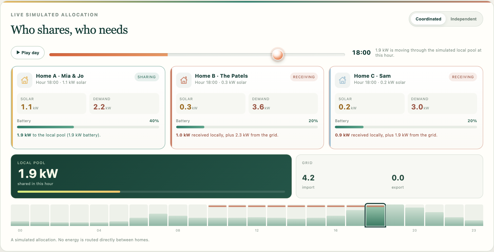

# SunShift Flex

**A simulated three-home solar-sharing prototype.** One home has spare rooftop solar; another has an evening need. SunShift Flex compares independent homes with a coordinated local allocation, hour by hour, on a clearly labelled synthetic day.

Built for the **Nebius Global AI Hackathon**, **Best Apps and Agents** track. It uses **NVIDIA Nemotron 3.5 Lightning** through **Nebius Token Factory** to interpret a plain-language household preference. The deterministic simulator, not the model, calculates every kWh, cost and balance.

> This is a prototype. The grid stays connected. Local sharing is a simulated or virtual allocation and settlement, not a direct wire between houses, a retailer agreement, a market bid or a grid approval. Results are modelled estimates, not measured savings.



## The problem

A neighbourhood can have solar on one roof and demand under another at the same time. A normal household-bill view hides that complementarity: each home is optimised alone, surplus is exported, and a neighbour imports at the retail rate. SunShift Flex makes the allocation question visible: what if eligible surplus could be offered locally first?

The app answers five questions at a glance:

- Which home has surplus?
- Which home needs energy?
- What can be shared in this scenario?
- What changed after coordination?
- How did Nemotron interpret the household preference?

## What the demo does

1. Loads a three-home synthetic neighbourhood in South Australia.
2. Lets you choose which home is yours and state a preference in plain language, or pick a labelled sample.
3. Calls Nemotron server-side to extract a strict set of constraints.
4. Validates those constraints and runs the deterministic simulator.
5. Animates a 24-hour day: solar, demand, battery state, local allocation, grid import and export.
6. Compares independent homes with the coordinated neighbourhood on identical inputs and tariffs.
7. Shows a plain-language explanation. The optional Nemotron explanation is qualitative only and is rejected if it contains a number.

## The AI workflow

```
Plain-language preference
  -> Nemotron via Nebius Token Factory
  -> strict JSON schema: reserve %, local-first, evening sharing, no-discharge window
  -> server validation
  -> deterministic simulator
  -> optional Nemotron explanation of the already-calculated result
```

- **Service:** Nebius Token Factory, OpenAI-compatible API.
- **Default model:** `nvidia/Nemotron-3_5-Lightning` (NVIDIA Nemotron 3.5 Lightning, 30B MoE with 3B active).
- **Base URL:** `https://api.tokenfactory.nebius.com/v1`
- **Override:** set `NEBIUS_MODEL` to another currently available NVIDIA Nemotron model on your Nebius account.
- **Key:** `NEBIUS_API_KEY` is read only by the Python server. It is never sent to the browser, committed, printed or logged.
- **Structured output:** the request uses `response_format: {"type":"json_schema", ...}` and the server validates every field again with Python. Invalid, missing or contradictory output is rejected; it is never turned into a preference object.
- **Failure:** if the key is absent or the API fails, the UI says so and uses the labelled manual sample. It does not fabricate a Nemotron result.
- **Logging:** one line per call with model, outcome, HTTP status and latency. No prompt, key or personal data.

The model is not allowed to invent energy values. Numbers in its explanation must match the supplied result summary; invented numbers, guarantees and measured-impact claims are rejected. All numbers come from the simulator.

Live verification on 2026-10-28: `nvidia/Nemotron-3_5-Lightning` through Nebius Token Factory returned validated constraints in about 1.8 to 2.7 seconds and a checked explanation in about 1.7 to 2.4 seconds. The key is not in the repository.

### Run with the model

```bash
cp .env.example .env        # add your key; the local server loads NEBIUS_* from this ignored file
# or: export NEBIUS_API_KEY="..."
python3 server.py
```

The server reads the process environment. Do not put a real key in `.env.example`, the repository, browser code or a screenshot.

## The deterministic model

`flex_model.py` simulates 24 one-hour intervals. Power is in kW and energy in kWh; for a one-hour interval, 1 kW = 1 kWh.

### Inputs

- Three homes, each with 24 hourly solar and demand values.
- Battery capacity, initial state of charge, reserve percentage, charge/discharge limits and round-trip efficiency.
- Grid import price, grid export price, local shared price and a per-interval transfer limit.
- Household preference: battery reserve, local-first choice, evening battery-sharing choice and an optional no-discharge window. Preferences apply to the selected home; other homes use their scenario reserve and share solar surplus by default.

### Per-home order in every interval

1. Solar serves own demand first.
2. Surplus charges the home's own battery within its charge limit and capacity.
3. Remaining demand is served by the home's battery above its reserve, unless the no-discharge window is active.
4. In the coordinated case, eligible surplus solar is offered to the local pool. If the selected home opted in, spare battery energy above reserve can also be offered in the evening (17:00 to 21:00).
5. The pool allocates at most the available supply, the eligible demand and the transfer limit. Allocation is proportional to demand, with other homes' evening demand prioritised when the preference is on.
6. Remaining demand imports from the grid. Remaining surplus exports to the grid.

The independent case uses the same solar, demand, batteries, reserve and no-discharge settings, but no local pool. This is the fair baseline.

### What is checked

- Solar balance and demand balance at every home and interval.
- Battery state-of-charge balance, capacity bounds, reserve floor, charge and discharge limits.
- No sharing above offered surplus, battery availability, eligible demand or the transfer limit.
- All flows finite and non-negative.
- The result reports `constraints.ok`, a list of violations and four named checks.

The default scenario has **zero violations**. If a violation is introduced, the UI reports it instead of hiding it.

### Costs

```
grid import cost = import kWh x import price
grid export credit = export kWh x export price
local purchase = shared-in kWh x shared price
local sale = shared-out kWh x shared price
household energy cost = import cost - export credit + local purchase - local sale
```

The neighbourhood total adds the households; local payments cancel, leaving grid import and export. Prices are energy-only. Daily supply, network, tax, retailer margin, losses and settlement are excluded. The UI shows the exact tariffs used.

### Monthly illustration

A monthly number is always the simulated sample day repeated 30 times, at the same tariffs and profiles. The UI states this next to the number. It is not a seasonal or annual forecast.

## Data

The scenario is **synthetic and illustrative**, not measured billing data. It is committed at `data/flex_scenario.json`; the same hourly profiles are available at `data/flex_homes_sample.csv` and through the in-app download.

- Home A: larger solar and battery; generally in surplus.
- Home B: family with a strong evening need.
- Home C: smaller solar, daytime and evening demand.

The app labels the scenario "Simulated scenario, not settlement data" and the source "Synthetic 24-hour profiles built for this prototype". No public dataset is fetched at runtime, so the demo works offline. If you replace the profiles with consented meter data, label that source and update the README; do not describe synthetic data as measured.

## Run locally

Requires Python 3.9 or newer. The app uses only the Python standard library.

```bash
cd sunshift-nem
python3 server.py
```

Open **http://127.0.0.1:8788**. The server binds only to loopback. No grid, retailer, meter or device connection is configured.

Optional model setup:

```bash
export NEBIUS_API_KEY="..."
export NEBIUS_MODEL="nvidia/Nemotron-3_5-Lightning"   # optional
python3 server.py
```

Without the key, the demo still runs with the manual sample and explicitly marks the AI as unavailable.

## Tests

```bash
python3 -m unittest discover -s tests -v
python3 -m py_compile server.py flex_model.py flex_ai.py vercel_api.py api/flex/*.py
node --check web/app.js
```

The current suite has 48 tests. It covers:

- energy balance and battery balance for every home and interval;
- reserve, no-discharge, charge/discharge and transfer limits;
- baseline versus coordinated calculations on identical inputs;
- tariff-based costs and the exact 30-day extrapolation;
- malformed and contradictory Nemotron output;
- missing key and API failure never producing a fake result;
- no key leakage in responses or logs;
- the hosted Flex routes and receipt guard.

## Browser demo path

1. Open the local URL. The three home cards show daily surplus and need.
2. Keep **Home A** selected. A sample preference is ready.
3. Click **Plan energy sharing**.
4. Read the **AI interpreted** panel. With a key, it shows the validated constraints and model name; without one, it says AI is unavailable and shows the manual sample.
5. Watch the stage. Use **Play day** or drag the hour slider.
6. Compare **Independent homes** with **Coordinated neighbourhood**.
7. Open **How the simulation works** for the chart, household table, constraint checks, tariffs and the 30-day assumption.
8. Optionally record the exact plan hash in the local hash-chain receipt. This is local only, not a blockchain transaction.

## Vercel preview

`vercel.json` serves the static UI and the `api/flex/*` Python functions. Set `NEBIUS_API_KEY` and `NEBIUS_MODEL` as Vercel environment variables, never in the repository. Hosted receipt recording is disabled because serverless storage is not a durable append-only ledger; the local app supports it.

```bash
vercel --prod
```

The repository includes an MIT licence. Before submission, make the repository public and confirm the licence is visible in the repository About section. The remote is `github.com/radhika-verma06/sunshift-nem`.

## What was added for the Nebius hackathon

The repository already contained a two-home NEM planner, a standard-library server, a deterministic optimizer, a local ledger and a premium static UI. For this submission the following were materially added:

- `flex_model.py`: a three-home, 24-interval deterministic simulator with batteries, reserve, no-discharge windows, local allocation, baseline comparison, costs, constraint checks and a 30-day illustration.
- `flex_ai.py`: the server-only Nebius Token Factory client with strict schema validation, a qualitative-only explanation guard, explicit unavailable/error states and secret-safe logging.
- `data/flex_scenario.json` and `data/flex_homes_sample.csv`: a labelled synthetic scenario.
- `web/index.html`, `web/app.js` and `web/flex.css`: a new Flex workflow inside the existing visual identity, including the three-home stage, hourly animation, AI panel, comparison, chart, validation table and local receipt path.
- Local and hosted routes under `/api/flex/*` plus Vercel rewrites.
- New model, AI, route and receipt tests; README, MIT licence and `.env.example`.

The existing optimizer, ledger, contracts and legacy routes remain in place for compatibility and are not used by the Flex main flow.

## Assumptions and limitations

- The three homes and their hourly profiles are synthetic. They are not measured billing, meter or settlement data.
- The model is deterministic and illustrative. It is not a network study, a retailer tariff engine, a market dispatch model or a financial forecast.
- Local allocation is a virtual accounting comparison. No electricity is routed directly between homes; the public grid remains connected.
- Battery efficiency is a fixed symmetric assumption. Degradation, temperature, inverter limits and standby losses are not modelled.
- Tariffs exclude daily supply, network charges, taxes, retailer margins and settlement. The user can change the energy prices and transfer limit, not the excluded charges.
- The monthly figure is exactly 30 repeated sample days. It has no seasonal, weather or demand variation.
- A real deployment needs consent, metering, a retailer or community-energy agreement, network approval, consumer protections and measured follow-up.
- The optional Nemotron explanation is qualitative and cannot add numbers. A live Nemotron call requires a configured `NEBIUS_API_KEY`; the repository does not contain one.
- The model catalogue changes. The default model ID is configurable and should be checked against the current Nebius catalogue before a live demo.

## Repository layout

```
flex_model.py                 deterministic three-home simulator
flex_ai.py                    server-only Nebius/Nemotron client and validation
server.py                     local API and static file server
web/index.html                Flex interface
web/app.js                    Flex UI controller
web/flex.css                  Flex-specific layer on the existing theme
web/styles.css, premium-3d.css  existing visual identity
data/flex_scenario.json       synthetic three-home scenario
data/flex_homes_sample.csv    same hourly profiles as CSV
api/flex/                     hosted routes: scenario, plan, interpret, explain, receipt, health
tests/                        model, AI, route, ledger and optimizer tests
docs/                         demo script and submission notes
```

## Licence

MIT. See [LICENSE](LICENSE).
